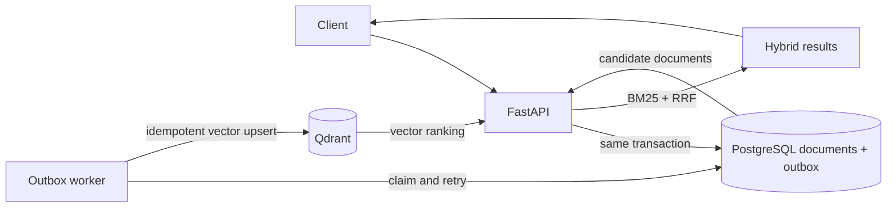

# AI & GenAI Engineering Playbook

A practical, modular study guide for an engineering graduate learning AI, machine
learning, generative AI, retrieval, and production LLM systems. Each concept has
its own guide and runnable Jupyter notebook. A separate reference application
connects FastAPI, PostgreSQL, Qdrant, BM25, reciprocal-rank fusion, and a
transactional outbox.

## Suggested GitHub repository

- **Repository name:** `ai-ml-genai-engineering-playbook`
- **Description:** `A hands-on AI/ML and GenAI engineering curriculum with 69 runnable notebooks, concept guides, and a FastAPI hybrid-search reference app.`

See [GitHub setup](guides/GITHUB_SETUP.md) for steps to create a new public or
private repository, push this workspace, and get started with the curriculum.

## Start here

1. Follow [GitHub setup](guides/GITHUB_SETUP.md) if you want to publish this
   workspace as your own repository.
2. Read the [learning roadmap](guides/ROADMAP.md) and follow its numbered order.
3. Use the [setup guide](guides/SETUP.md), then read a concept guide and run its
   matching notebook.
4. Build and run the [hybrid-search API](examples/hybrid_search_api/README.md)
   when you reach retrieval and production architecture.

The roadmap is organized from fundamentals to production systems, but every
concept guide and notebook can also be studied independently. Notebooks use
small, reproducible examples; cloud/provider lessons explain where credentials
and paid resources are required. No credentials are needed for the core lessons.

## Repository map

```text
guides/
  ROADMAP.md
  SETUP.md
  concepts/                  One focused guide per concept
notebooks/                   One matching Jupyter notebook per concept
examples/
  hybrid_search_api/         FastAPI + PostgreSQL + Qdrant reference application
  integrations/              Framework and model-provider examples
tests/                       Offline tests for ranking and API behavior
```

## Reference application



The example's hash-based vectorizer is deterministic and dependency-light; it
is a wiring demonstration, **not** a semantic embedding model. Replace it with
a real embedding provider before using the system for relevance-sensitive work.
The outbox makes the PostgreSQL write and indexing request atomic; Qdrant
delivery is asynchronous and at-least-once, so the worker uses idempotent
upserts.

## Prerequisites

- Python 3.11 or newer (the notebooks and reference app use ordinary Python;
  choose a Jupyter-compatible interpreter for your environment).
- Docker Desktop or Docker Engine with Compose for the reference application.
- JupyterLab or VS Code's Jupyter extension for notebooks.

See [setup](guides/SETUP.md), [contribution guidance](CONTRIBUTING.md), and
[security guidance](SECURITY.md).

## Scope and learning outcomes

The 69-lesson curriculum starts with Python, data preparation, linear algebra,
and probability, then builds through supervised, unsupervised,
semi-supervised, and reinforcement learning; classical models, recommendation
systems, feature engineering, neural networks, and deep learning; NLP
representations, Word2Vec, embeddings, attention, Transformers, and LLMs; and
retrieval, agents, evaluation, responsible AI, deployment, and model-provider
integrations.

The goal is a practical engineering foundation, not an exhaustive catalog.
Advanced electives such as causal inference, time-series forecasting, graph
neural networks, Bayesian modeling, distributed training, and specialized
reinforcement-learning methods can be added as follow-on tracks. See the
[roadmap](guides/ROADMAP.md) for sequencing and scope boundaries.

## License

This repository is provided for educational use under the MIT License. See
[LICENSE](LICENSE).
