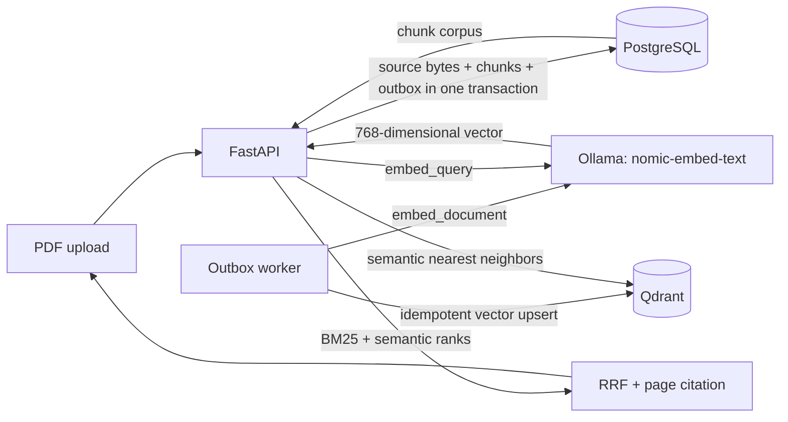
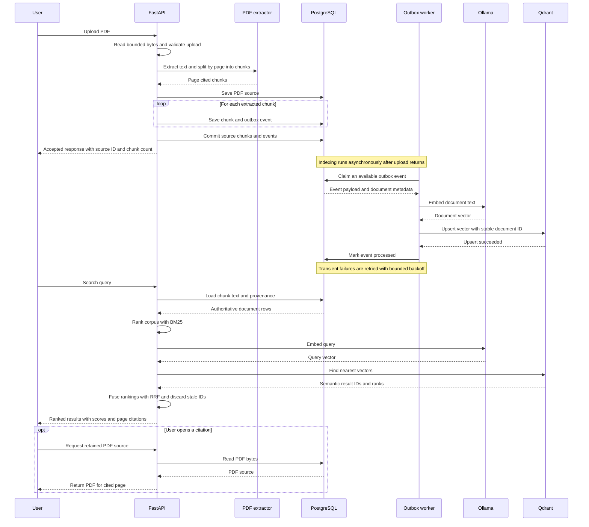

# PDF hybrid-search API

A local reference architecture for accepting PDFs, extracting page-cited text
chunks, and retrieving evidence with BM25 and a Docker Compose-hosted Ollama
embedding model. Reciprocal-rank fusion (RRF) merges the ranked lists; results
include a URL to the retained PDF and the exact source page.



## What this API does

This reference API demonstrates a retrieval pipeline for asking questions over
PDFs while keeping each result tied to its source page. It does not generate an
answer: it returns ranked evidence passages and links back to the original PDF
so a person or a later answer-generation step can verify the evidence.

The pipeline uses two complementary retrieval methods:

- **BM25 (lexical search)** ranks chunks that share meaningful words with the
  query. It is useful for exact names, identifiers, and phrases, but can miss a
  relevant passage when it uses different wording.
- **Semantic search** embeds the query with Ollama and finds nearby chunk
  vectors in Qdrant. It can match related meanings despite different wording,
  but may be less precise for exact terms.
- **Reciprocal-rank fusion (RRF)** combines the two ranked lists by rank rather
  than comparing their differently scaled raw scores. This gives the response
  a single hybrid ordering.

PostgreSQL is the source of truth for uploaded bytes, extracted text, and
provenance. Qdrant stores vectors for semantic retrieval. The API reads result
text and page metadata from PostgreSQL, so a vector match alone cannot supply
unverified or stale chunk content. PDF upload returns `202 Accepted` after the
source, chunks, and indexing events are committed; the worker creates vectors
asynchronously. Consequently, a newly uploaded chunk can be available to BM25
before its semantic vector has been indexed.

### Life of an upload and search request

The diagram shows the API request/response path, then the asynchronous outbox
worker, followed by a separate search request. Each outbox event is committed
alongside its chunk, preventing accepted content from losing its indexing
request. The worker upserts vectors using stable document IDs and marks events
processed only after Qdrant succeeds.



In the search response, `matched_by` indicates which retrievers returned a
chunk. `bm25_score` is present for lexical matches, `semantic_rank` for vector
matches, and `rrf_score` for the combined ranking. For PDF chunks, `citation`
identifies the filename and one-based page number, while `source_url` opens the
retained PDF at that page in compatible PDF viewers.

## Run on Docker Desktop

Requirements: Docker Desktop with Compose enabled and approximately 4 GB or
more of memory available to containers. The default Ollama model runs on CPU;
the first start downloads the image and `nomic-embed-text` model, so allow a
few minutes and keep Docker Desktop online.

From the repository root in PowerShell:

```powershell
docker compose -f examples/hybrid_search_api/compose.yaml up --build
```

Compose starts PostgreSQL, Qdrant, Ollama, downloads the configured embedding
model once into a named volume, then starts the API and worker. The API waits
for the model-download service to complete. Its successful exit is expected;
the `ollama`, `postgres`, `qdrant`, `api`, and `worker` services should remain
running.

PostgreSQL is published on `127.0.0.1:5433` by default. If that host port is
unavailable, set another host port before starting Compose:

```powershell
$env:POSTGRES_HOST_PORT = "15432"
docker compose -f examples/hybrid_search_api/compose.yaml up --build
```

Open [http://localhost:8000/docs](http://localhost:8000/docs) for the API UI.
Upload a PDF in `POST /documents/pdf`, or use PowerShell:

```powershell
$form = @{ file = Get-Item ".\sample.pdf" }
$upload = Invoke-RestMethod `
  -Method Post `
  -Uri "http://localhost:8000/documents/pdf" `
  -Form $form
$upload
```

The response contains a `source_id`, number of text-bearing pages and chunks,
and a `source_url`. PDF source bytes and extracted chunks are stored in
PostgreSQL; the PDF is served back at that URL so page citations resolve to the
original source. The original filename is stored only as display metadata, not
as a filesystem path.

Search for evidence:

```powershell
$query = [uri]::EscapeDataString("How long is the return period?")
$results = Invoke-RestMethod -Uri "http://localhost:8000/search?q=$query&limit=5"
$results.results | Format-List
```

Each result contains `content`, `bm25_score`, `semantic_rank`, `rrf_score`,
`matched_by`, `citation` (for example `policy.pdf#page=3`), and `source_url`
(for example `/documents/<source-id>/pdf#page=3`). Open a citation in the
browser with:

```powershell
Start-Process "http://localhost:8000$($results.results[0].source_url)"
```

The URL fragment asks a PDF viewer to open the cited page. `citation` identifies
the evidence location; it does not claim that a generated answer is supported.
This project retrieves passages but intentionally does not generate answers.

Watch indexing and service startup:

```powershell
docker compose -f examples/hybrid_search_api/compose.yaml logs -f ollama-model api worker
```

Stop containers while preserving the database, vectors, uploaded PDFs, and
downloaded model:

```powershell
docker compose -f examples/hybrid_search_api/compose.yaml down
```

**Destructive cleanup:** `docker compose -f examples/hybrid_search_api/compose.yaml down -v`
also removes all named volumes, including uploaded source PDFs and the Ollama
model download.

## Retrieval implementation

- **PDF extraction:** `app/pdf_ingestion.py` uses `pypdf`, preserves one-based
  page numbers, and makes overlapping chunks of at most 400 whitespace tokens
  and 6,000 characters. Uploads are limited to 20 MiB, 500 pages, and 5 million
  extracted characters. Encrypted files and PDFs with no extractable text are
  rejected. OCR is not included.
- **Embedding model:** Ollama serves `nomic-embed-text` from a local container.
  The worker uses its `search_document:` prefix and the API uses `search_query:`
  so indexing and retrieval follow the model's asymmetric-search convention.
  The expected vector size is 768. Changing model or vector dimensions requires
  a new collection and reindex.
- **BM25:** `app/retrieval.py` implements BM25 with Python standard-library
  tokenization and counters. It uses Unicode normalization, document-frequency
  IDF, document-length normalization, and a configurable title boost, and
  returns reproducibly ordered scores. It rebuilds corpus statistics from
  PostgreSQL rows for each request; this is intentionally a small-corpus demo,
  not a high-throughput search index.
- **RRF:** Reciprocal-rank fusion combines the BM25 and Qdrant rank lists
  without comparing their incompatible raw score scales. A document votes
  once per retriever, and stable ID ordering resolves ties.
- **Grounding:** Each indexed chunk carries `source_id`, `source_name`,
  one-based `page_number`, and `chunk_index`. Search responses are resolved
  against PostgreSQL, which is authoritative for chunk text and source
  metadata; stale vector IDs are discarded.
- **Reliable ingestion:** A PDF source, its page chunks, and one outbox event
  per chunk are committed together. The worker leases events with
  `FOR UPDATE SKIP LOCKED`, embeds asynchronously, then upserts by stable
  document UUID. Transient embedding/Qdrant errors are retried with bounded
  exponential backoff.

## Run tests and lint

Install the project's dependencies, then run:

```powershell
python -m pip install -e ".[dev,notebooks]"
python -m pytest -q
python -m ruff check .
```

The unit tests mock the embedding model, Qdrant, and database where needed, so
they do not require Docker, model downloads, cloud credentials, or network
access.

## Develop without starting the services

The supported complete local setup is Docker Compose so the API, worker,
PostgreSQL, Qdrant, and Ollama share consistent service URLs. For code-only
development and tests, install the package in the repository's Python
environment and run the test commands above; the unit tests mock the external
services.

## Limitations and production considerations

- The API and services bind to loopback for local study. The demo has no
  authentication, tenant isolation, quotas, or access-control filtering; do
  not expose it to untrusted networks.
- Uploaded PDFs are retained in PostgreSQL. Define authorization, retention,
  deletion, malware scanning, and data-handling rules before using private or
  regulated documents.
- A filename/page citation points to an extracted source location; extraction
  can be imperfect, and there is no OCR, layout/table preservation, or
  page-level extraction confidence.
- BM25 currently loads the corpus into the API process. For larger corpora,
  move lexical retrieval to PostgreSQL full-text search or a dedicated search
  service, and evaluate recall before replacing the demo ranker.
- Add authentication, rate limiting, resource quotas, observability, durable
  dead-letter handling, and authorization filters before production use.
