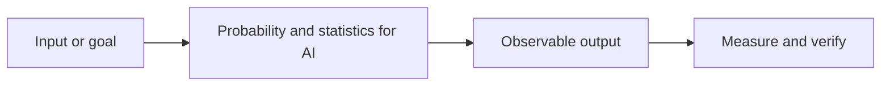

# Probability and statistics for AI

**Track:** Foundations  
**Notebook:** [Open the hands-on lesson](../../notebooks/004-probability-statistics.ipynb)

## What it is

Statistics summarizes data and uncertainty; probability describes uncertainty in outcomes and model predictions.

## Intuition

Statistics describes the measurements you observed; probability quantifies what might happen next.

## How to reason about it

Start from the input and desired output. Identify what the method learns or
stores, what assumptions it makes, and how you will measure whether it works.
For production use, also define data boundaries, latency/cost limits, and a
safe failure path.

## Concept map

## Small example

Estimate a positive-event rate and calculate a simple conditional probability from counts.

## Engineering case study

Compare model error rates across equipment groups without confusing noisy samples with reliable evidence.

## Trade-offs and common mistakes

- Treat a useful analogy or demo as an intuition, not proof of production
  quality.
- Compare against a simple baseline and inspect examples where it fails.
- Avoid data leakage: split evaluation data before fitting or tuning.
- Keep provenance and privacy requirements visible when using external data
  or hosted models.
- Measure the end-to-end user outcome, not only a model score.

## Practice

1. Run the matching notebook and explain each code cell in your own words.
2. Change one input or assumption. Predict the outcome before rerunning.
3. Write one test that would catch a plausible failure in the case study.
4. Record what you would need to validate before deploying the idea.

## Related concepts

Use the [roadmap](../ROADMAP.md) to follow prerequisites and neighboring topics.
The [hybrid-search reference app](../../examples/hybrid_search_api/README.md)
shows how several search and production concepts fit together.
