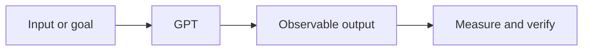

# GPT

**Track:** Language models  
**Notebook:** [Open the hands-on lesson](../../notebooks/035-gpt.ipynb)

## What it is

GPT-style models are decoder-only Transformers trained to predict the next token, then adapted for useful generation.

## Intuition

It writes one word at a time, using everything already written as context.

## How to reason about it

Start from the input and desired output. Identify what the method learns or
stores, what assumptions it makes, and how you will measure whether it works.
For production use, also define data boundaries, latency/cost limits, and a
safe failure path.

## Concept map

## Small example

Show how a next-token choice extends a prompt by one token.

## Engineering case study

Generate a draft answer, then require retrieval, validation, and human review where correctness matters.

## Trade-offs and common mistakes

- Treat a useful analogy or demo as an intuition, not proof of production
  quality.
- Compare against a simple baseline and inspect examples where it fails.
- Avoid data leakage: split evaluation data before fitting or tuning.
- Keep provenance and privacy requirements visible when using external data
  or hosted models.
- Measure the end-to-end user outcome, not only a model score.

## Practice

1. Run the matching notebook and explain each code cell in your own words.
2. Change one input or assumption. Predict the outcome before rerunning.
3. Write one test that would catch a plausible failure in the case study.
4. Record what you would need to validate before deploying the idea.

## Related concepts

Use the [roadmap](../ROADMAP.md) to follow prerequisites and neighboring topics.
The [hybrid-search reference app](../../examples/hybrid_search_api/README.md)
shows how several search and production concepts fit together.
