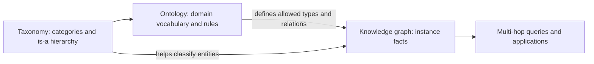

# Taxonomy vs ontology vs knowledge graph

**Track:** Search and knowledge representation

**Notebook:** [Open the hands-on lesson](../../notebooks/048-knowledge-graphs.ipynb)

## Why these concepts are easy to mix up

All three organize information, but they answer different questions:

- A **taxonomy** answers: "What kinds of things are these, and where do they
  fit in a hierarchy?"
- An **ontology** answers: "What kinds of things and relationships exist, and
  what rules make statements about them valid?"
- A **knowledge graph** answers: "What specific entities and facts do we know,
  and how are they connected?"

They are complementary, not competing technologies. A knowledge graph may use
an ontology as its schema and a taxonomy as part of its class hierarchy.

## Intuition: filing system, rulebook, and facts

Imagine a product-support system:

- The **taxonomy** is a tree of folders: `Product > Device > Sensor`.
- The **ontology** defines the vocabulary and rules: a `Device` may
  `use_firmware`, and that relationship must connect a device to a firmware
  release.
- The **knowledge graph** records actual facts: `Device-D1 uses Firmware-2.4`,
  and `Firmware-2.4 is affected by Advisory-A9`.

The taxonomy helps classify and browse. The ontology makes data meaning
consistent and checkable. The graph connects real-world instances so users can
query across relationships.

## Compare their purpose

| Concept | Main structure | Primary purpose | Example question |
|---|---|---|---|
| Taxonomy | Usually a parent-child hierarchy | Categorize, browse, and aggregate | "Which products are devices?" |
| Ontology | Classes, properties, relationships, and constraints | Define shared meaning and valid statements | "Can a firmware release be installed in a team?" |
| Knowledge graph | Entity nodes and relationship edges, often with attributes and provenance | Store and query facts about particular entities | "Which devices use firmware affected by this advisory?" |

### Taxonomy

A taxonomy is a controlled classification, commonly a tree or a directed
hierarchy. A child category is a more specific kind of its parent:
`Sensor is_a Device`, and `Device is_a Product`. It is useful for navigation,
consistent tagging, catalog organization, and roll-up reporting.

A taxonomy is intentionally limited. It does not usually model rich relations
such as "manufactured by", rules such as "a device must have a serial number",
or facts about an individual device. Real vocabularies may have multiple
parents; at that point the structure is a hierarchy or polyhierarchy rather
than a strict tree.

### Ontology

An ontology is a formal model of a domain. It defines concepts (classes),
relationships and attributes (properties), and may define constraints or
logical axioms. For example, `uses_firmware` can specify that its subject is a
`Device` and its object is a `FirmwareRelease`. A richer ontology can express
that every device must have a manufacturer or that one class is a subtype of
another.

Ontologies are useful when systems or teams need to exchange data without
silently disagreeing about what a field or relationship means. Depending on
the language and reasoner, ontology rules can also infer additional facts or
detect contradictions. A lightweight schema validator is useful, but it is
not the same as a full logical reasoner.

### Knowledge graph

A knowledge graph represents specific entities and their typed relationships.
A common representation is a triple:
`(subject, relation, object)`, such as
`(Device-D1, uses_firmware, Firmware-2.4)`. Graphs can also keep attributes,
timestamps, confidence, and source provenance on entities or facts.

Graphs are useful for multi-hop questions, impact analysis, entity linking,
recommendations, and combining facts from different systems. An ontology can
constrain which node types and edge types are allowed; the graph holds the
instance-level statements. A graph can exist without a formal ontology, but
its vocabulary and data quality may then be less consistent.

## How they fit together

In practice, teams often start with a small, useful taxonomy, make the
important concepts and relationships explicit in an ontology, then populate a
knowledge graph from reliable sources. The process is iterative: graph use
cases reveal missing concepts, bad classifications, and rules that need to be
clarified.

## Engineering case study: product advisory impact

Suppose an incident team asks: "Which components in our deployed devices are
affected by advisory A9?"

1. **Taxonomy:** classify `Battery-B7` as a `Component`, `Device-D1` as a
   `Device`, and both under the broader `Product` category.
2. **Ontology:** define allowed links such as
   `Component installed_in Device`,
   `Device uses_firmware FirmwareRelease`, and
   `FirmwareRelease affected_by Advisory`.
3. **Knowledge graph:** store the actual product, firmware, and advisory facts
   with source and last-verified metadata.
4. **Query:** traverse from component through device and firmware to find the
   advisory. Return the path and its provenance so an engineer can verify it.

The taxonomy makes categories easy to browse, the ontology catches
ill-typed facts, and the graph answers the cross-system impact question.

## When to use each

- Use a **taxonomy** when the primary need is category assignment, navigation,
  or grouped reporting.
- Use an **ontology** when multiple producers and consumers need shared,
  machine-readable domain semantics or validation rules.
- Use a **knowledge graph** when important questions depend on relationships
  across entities, especially across more than one hop.
- Combine them when the use case needs all three: controlled categories,
  consistent relationship semantics, and queryable instance facts.

## Trade-offs and common mistakes

- Do not call every nested list an ontology; a hierarchy alone is usually a
  taxonomy.
- Do not assume a knowledge graph automatically has a well-designed ontology
  or clean data.
- Keep category hierarchies understandable; excessive or inconsistent
  categories make tagging and reporting unreliable.
- Version ontology changes and plan how existing graph data will be migrated.
- Preserve provenance, timestamps, and confidence for facts extracted from
  documents or generated by models.
- Separate explicit source facts from inferred facts, and explain which rules
  produced an inference.
- Begin with representative queries and verify that the modeled relationships
  can answer them before choosing a graph database.

## Practice

1. Run the matching notebook and compare its taxonomy, ontology schema, and
   knowledge-graph facts.
2. Add a new category and a valid relationship; then try a fact with an
   invalid domain or range and observe the validator.
3. Write one multi-hop question the graph can answer and identify which
   facts/provenance support the result.
4. Identify which part of a proposed catalog problem needs only a taxonomy,
   which needs ontology rules, and which truly benefits from a graph.

## Related concepts

Continue with [GraphRAG](049-graphrag.md) to see how graph structure can help
retrieve evidence across connected facts. The
[hybrid-search reference app](../../examples/hybrid_search_api/README.md)
shows complementary lexical, vector, and rank-fusion retrieval.
