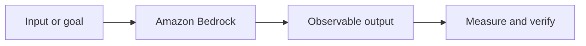

# Amazon Bedrock

**Track:** Integrations  
**Notebook:** [Open the hands-on lesson](../../notebooks/069-amazon-bedrock.ipynb)

## What it is

Amazon Bedrock provides managed access to foundation models and related capabilities through AWS APIs.

## Intuition

A managed model catalog can simplify access, while model selection, permissions, and cost remain application decisions.

## How to reason about it

Start from the input and desired output. Identify what the method learns or
stores, what assumptions it makes, and how you will measure whether it works.
For production use, also define data boundaries, latency/cost limits, and a
safe failure path.

## Concept map

## Small example

Check the configured AWS region without making a network request.

## Engineering case study

Compare approved model options for a RAG application and grant only the required model invocation permission.

## Trade-offs and common mistakes

- Treat a useful analogy or demo as an intuition, not proof of production
  quality.
- Compare against a simple baseline and inspect examples where it fails.
- Avoid data leakage: split evaluation data before fitting or tuning.
- Keep provenance and privacy requirements visible when using external data
  or hosted models.
- Measure the end-to-end user outcome, not only a model score.

## Practice

1. Run the matching notebook and explain each code cell in your own words.
2. Change one input or assumption. Predict the outcome before rerunning.
3. Write one test that would catch a plausible failure in the case study.
4. Record what you would need to validate before deploying the idea.

## Related concepts

Use the [roadmap](../ROADMAP.md) to follow prerequisites and neighboring topics.
The [hybrid-search reference app](../../examples/hybrid_search_api/README.md)
shows how several search and production concepts fit together.
