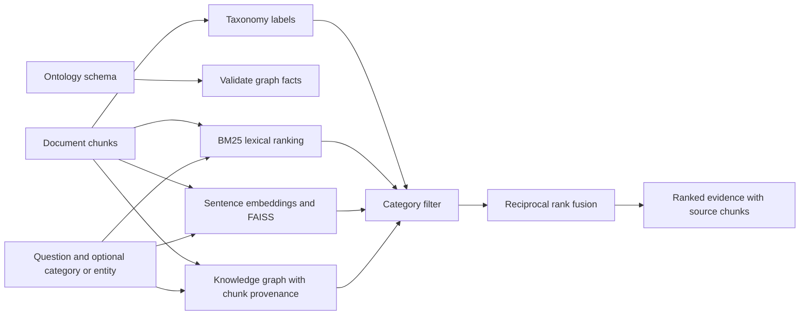

# Hybrid document search with taxonomy, ontology, and knowledge graphs

**Track:** Applied search and knowledge representation

**Notebook:** [Open the runnable lesson](../../notebooks/071-hybrid-document-search.ipynb)

**Prerequisite:** [Semantic document search with FAISS](070-semantic-document-search.md)

## What this example combines

Hybrid document search brings together multiple ways to identify useful
evidence:

- **Lexical retrieval** finds passages sharing important terms with the query.
  BM25 is useful for exact names, IDs, and phrases.
- **Semantic retrieval** uses the embedding-and-FAISS approach from lesson
  070 to find passages with related meaning even when wording differs.
- **Graph retrieval** follows explicit entity relationships to find supporting
  passages connected to a named entity or fact.
- **Reciprocal-rank fusion (RRF)** combines ranked candidate lists without
  treating BM25 scores, vector similarities, and graph matches as though they
  shared the same numeric scale.

The knowledge representation pieces have different jobs:

| Piece | Purpose in this search example |
|---|---|
| Taxonomy | Classify passages, then filter to a category or any descendant category |
| Ontology | Declare valid entity types and relation domain/range rules |
| Knowledge graph | Store instance facts with their supporting chunk IDs |
| Search indexes | Retrieve passages through lexical, vector, and graph paths |
| RRF | Combine the independent rankings into one result order |

These are complementary. The taxonomy organizes classes; the ontology defines
meaning and constraints; the graph stores instance facts. Search combines the
returned evidence rather than treating one representation as a replacement
for the others.

## Example domain

The notebook models a fictional device support corpus. It uses facts such as
`Battery-B7 installed_in Device-D1` and
`Firmware-2.4 affected_by Advisory-A9`, each linked to the document chunk that
supports it. It then finds evidence for a question about a device and its
security advisories.

## Request flow

1. A user supplies a query and may provide a taxonomy category filter or a
   starting entity.
2. The taxonomy filter keeps documents in the requested category or a
   descendant. This constrains all retrieval paths consistently.
3. BM25 ranks text chunks by lexical relevance.
4. The embedding model and FAISS rank chunks by semantic similarity.
5. If an entity is supplied, graph traversal finds related facts and the
   chunks that support those facts. The ontology validates fact types before
   those relations are used.
6. RRF merges the lexical, semantic, and graph rankings. Each result includes
   the methods that retrieved it and the source chunk to inspect.

The first semantic-search run downloads `all-MiniLM-L6-v2` from Hugging Face.
Install dependencies as described in lesson 070; no API credentials are used.

## Why use each part?

- **Taxonomy filtering** narrows the search domain, for example to security
  notices, without changing the query text.
- **Ontology validation** catches an ill-typed fact, such as claiming a
  battery is installed in a firmware release, before graph traversal uses it.
- **Knowledge graph traversal** answers relational questions that may not be
  stated in one passage, such as identifying the advisory for firmware used by
  a particular device.
- **Lexical and semantic retrieval** provide complementary passage matches:
  exact identifiers and terms on one side, paraphrases and related wording on
  the other.
- **RRF** gives each retriever a rank-based vote and avoids adding together
  incomparable raw scores.

## Trade-offs and safe use

- Metadata filters are only as trustworthy as the taxonomy labels and
  authorization rules used to produce them.
- An ontology-style validator in a small application is not automatically a
  formal logic reasoner. This notebook checks declared type constraints only.
- Graph facts must keep source provenance. A traversal result is not evidence
  unless its supporting source can be inspected.
- Extracted or model-generated facts may be wrong. Keep inferred facts
  distinguishable from directly verified facts and require review for
  high-impact use.
- Graph retrieval can improve recall for linked entities but can also add
  irrelevant neighbors. Evaluate graph depth and relation selection.
- FAISS's flat index is exact, in-memory, and rebuilt in the notebook. Use an
  appropriate persistent or approximate index for larger collections.
- Search results are evidence candidates, not generated answers or guarantees
  of correctness.

## Practice

1. Run [lesson 070](070-semantic-document-search.md) first, then execute this
   notebook from top to bottom.
2. Compare results with and without a category filter.
3. Search with and without a starting entity; inspect which sources graph
   traversal adds.
4. Add an invalid relation fact and verify that ontology validation rejects
   it.
5. Remove one retriever's ranked list and compare the fused order.
6. Build a small judged query set and measure recall@k, precision@k, and
   citation correctness before deploying.

## Related concepts

Continue with [knowledge graphs](048-knowledge-graphs.md),
[GraphRAG](049-graphrag.md), [BM25](044-bm25.md), [semantic search](045-semantic-search.md),
and [reciprocal-rank fusion](046-rrf.md). The
[hybrid-search API](../../examples/hybrid_search_api/README.md) shows a
production-oriented alternative using PostgreSQL, Ollama, Qdrant, and an
outbox worker.

For an orchestrated agent version with a visible LangGraph DAG and optional
local answer generation, continue to
[Hybrid document-search agent with LangGraph and Ollama](072-hybrid-document-search-agent.md).
