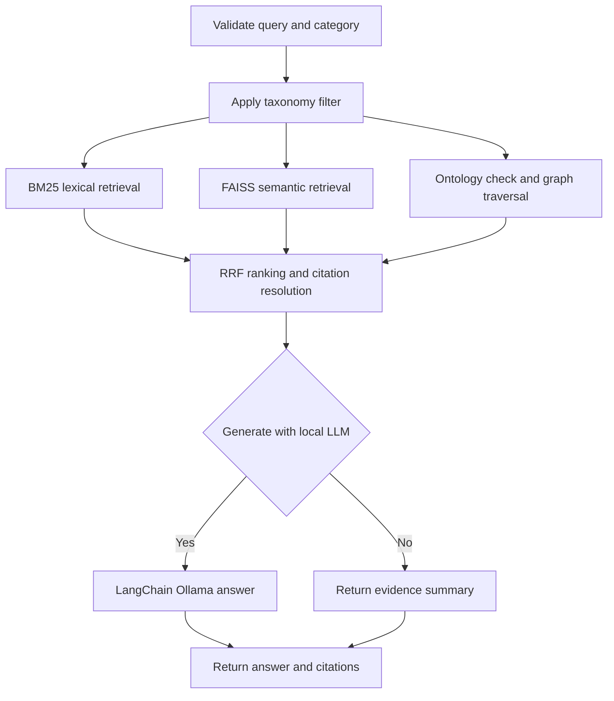

# Hybrid document-search agent with LangGraph and Ollama

**Track:** Applied search and agent orchestration

**Notebook:** [Open the runnable lesson](../../notebooks/072-hybrid-document-search-agent.ipynb)

**Prerequisites:** [Hybrid document search](071-hybrid-document-search.md),
[LangChain](054-langchain.md), [LangGraph](055-langgraph.md), and
[Ollama](063-ollama.md).

## What this lesson builds

This notebook wraps taxonomy-aware hybrid retrieval in a LangGraph workflow.
The graph validates a request, applies a category hierarchy, runs lexical,
semantic, and knowledge-graph retrieval branches, fuses their rankings with
reciprocal-rank fusion, and returns source-linked evidence. An optional final
node uses a local Ollama chat model through LangChain to write a concise answer
from only those evidence passages.

Retrieval works independently of generation. By default, the graph returns
evidence and a deterministic evidence summary. Set `generate_answer=True` only
when the local model is running and you want to explore answer synthesis.

## Why use LangGraph?

The stages have explicit inputs and outputs, and lexical, vector, and graph
retrieval can run as parallel branches after the same validated/filtering
stage. LangGraph makes those dependencies visible as a directed graph, carries
state between nodes, and supports conditional routing to the optional LLM node.
LangChain supplies the Ollama chat-model adapter and prompt/output chain.

### Workflow DAG



### What each stage contributes

1. **Validate request:** Reject empty queries and unknown categories explicitly.
2. **Taxonomy filter:** Restrict every retriever to the same category and its
   descendants, preserving a consistent boundary.
3. **Parallel retrieval:** BM25 favors exact terms; FAISS embeddings find
   related wording; graph traversal finds evidence connected to an entity.
4. **Ontology validation:** Only accept graph facts whose subject and object
   types match the declared relationship domain and range.
5. **RRF and citation resolution:** Combine ranks without adding incomparable
   raw scores, then resolve IDs to authoritative chunk text and source/page.
6. **Optional generation:** LangChain formats evidence as context and calls
   Ollama. The prompt requires source citations and instructs the model to
   abstain when the evidence is insufficient.

## Run locally

From the repository root, install:

```powershell
python -m pip install -e ".[dev,notebooks,langchain,langgraph]"
```

The first embedding run downloads `all-MiniLM-L6-v2` from Hugging Face. To use
the optional LLM, start an Ollama container with Docker Desktop:

```powershell
docker run -d --name playbook-ollama -p 11434:11434 `
  -v playbook-ollama-data:/root/.ollama ollama/ollama
docker exec playbook-ollama ollama pull qwen2.5:3b
```

The notebook connects to `http://localhost:11434` by default. Override
`OLLAMA_BASE_URL` and `OLLAMA_MODEL` if your Ollama endpoint or model differs.
When the notebook itself runs inside a container, the host service is commonly
reachable as `http://host.docker.internal:11434`; networking depends on the
container runtime configuration.

In the notebook, render the compiled graph's Mermaid diagram, then invoke the
workflow first with `generate_answer=False`. Set it to `True` only after the
Ollama model is available. Model or network errors are shown rather than
silently replaced with a generated-looking response.

## Safety and evaluation

- The graph facts and category labels in the notebook are curated toy data;
  real extracted facts require source validation and provenance.
- The ontology check enforces declared domain/range types; it is not a full
  description-logic reasoner.
- The model is instructed to use the retrieved context, but prompts do not
  guarantee factual answers. Always inspect the returned chunks and citations.
- Do not send private documents to a model without an approved data-handling
  policy. A local model reduces external transmission but does not itself
  provide authorization, encryption, or retention controls.
- Measure retrieval with representative queries and judged source chunks.
  Evaluate generation separately for faithfulness, citation correctness,
  abstention, latency, and resource use.
- This is a learning example, not a production agent service. Add access
  control, timeouts, observability, resource limits, and robust model lifecycle
  management before deployment.

## Continue learning

Compare this orchestrated workflow with
[the standalone hybrid search notebook](071-hybrid-document-search.md), then
continue with [LangGraph](055-langgraph.md),
[the agent loop](052-agent-loop.md), and
[LLM evaluation](041-llm-evaluation.md).
